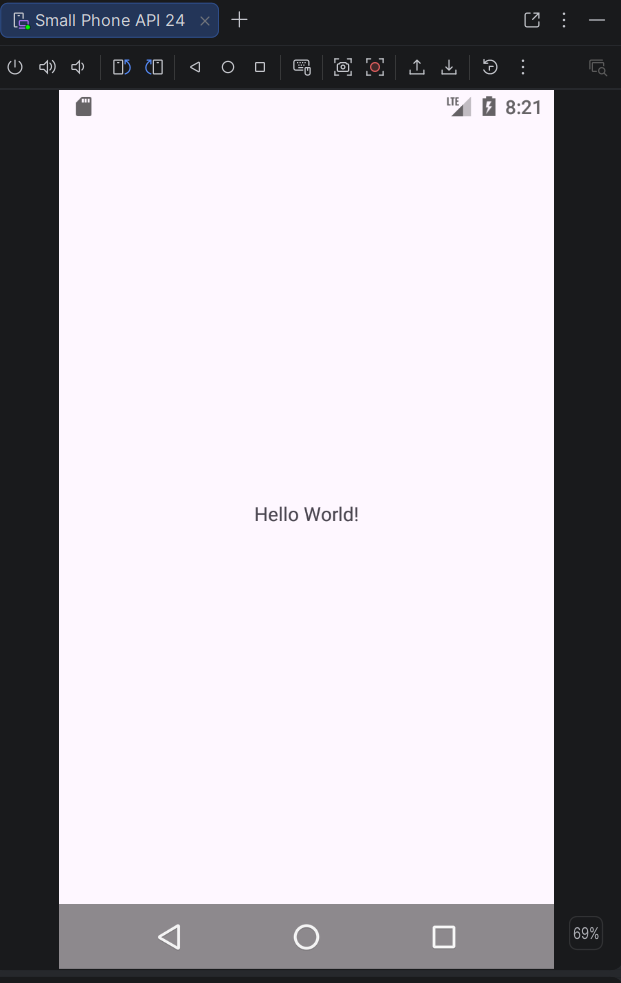
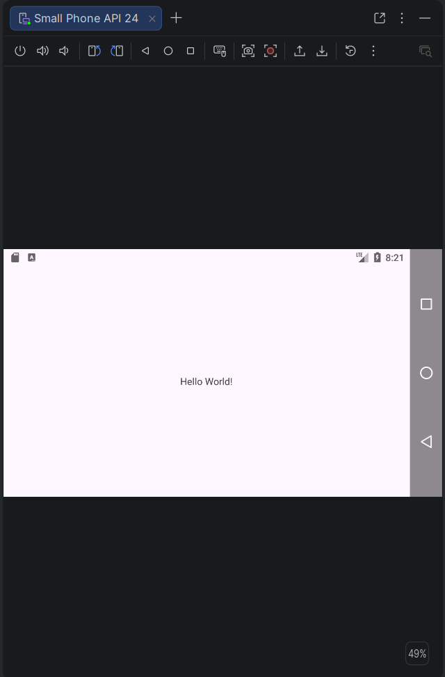
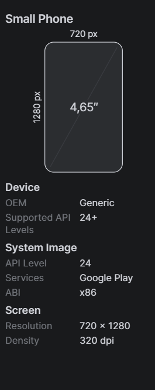
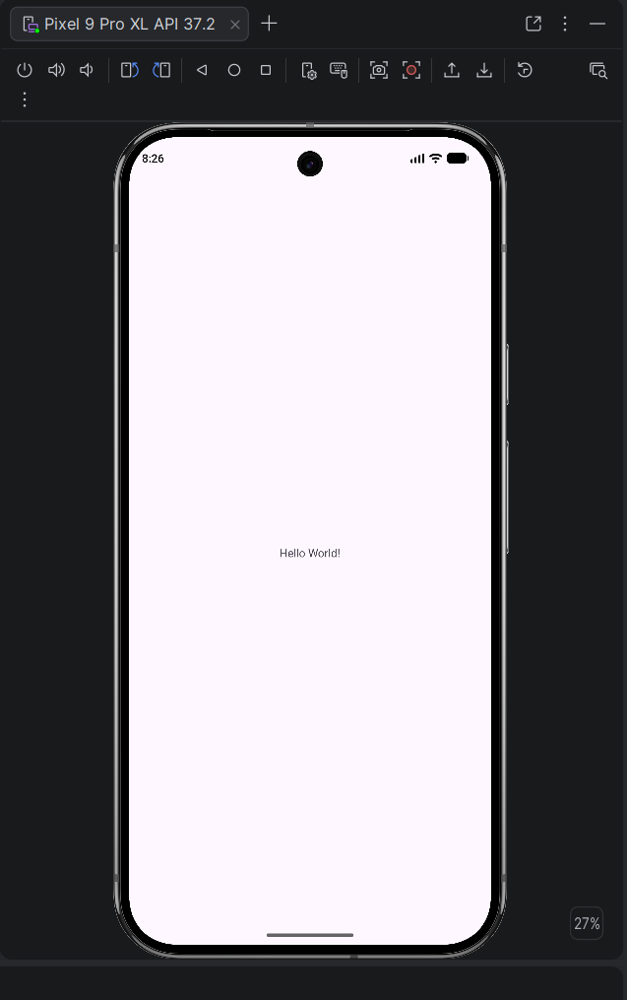
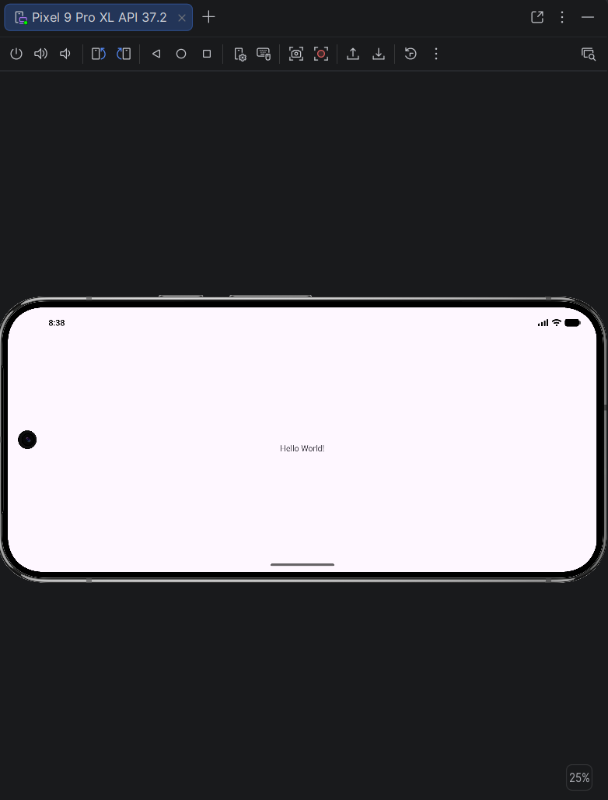
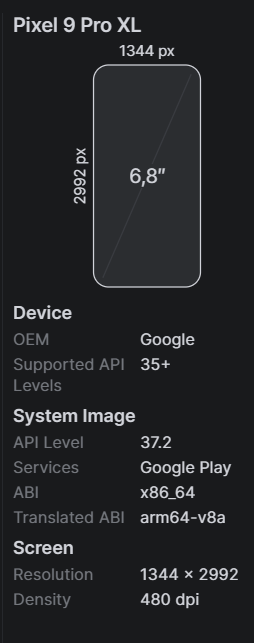
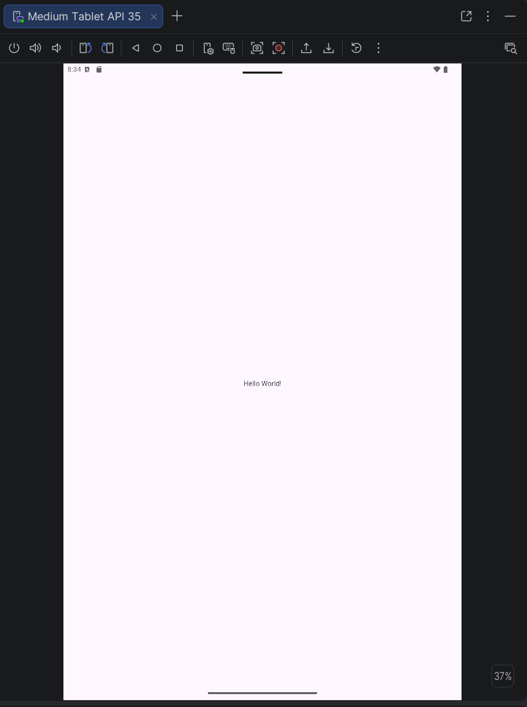
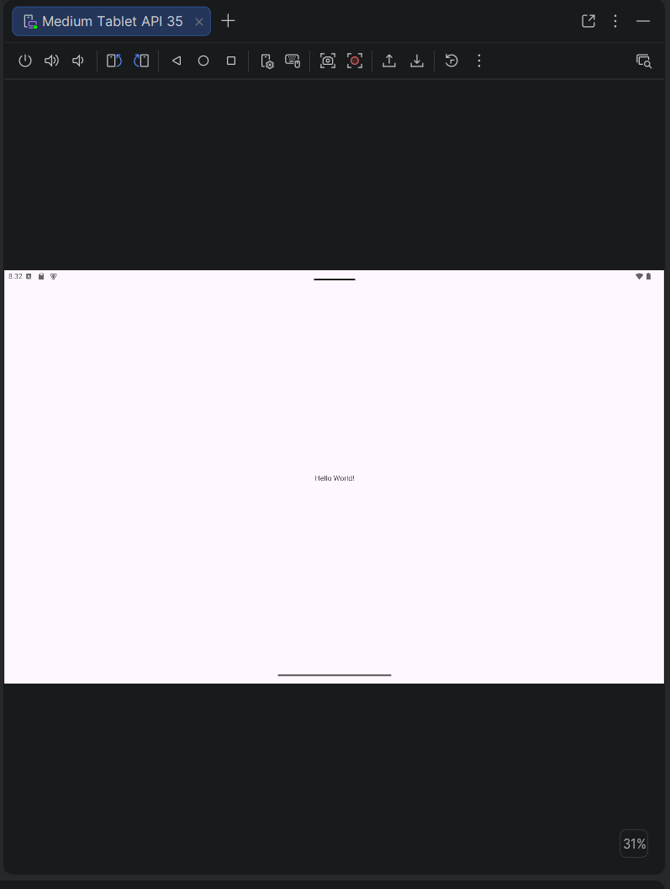
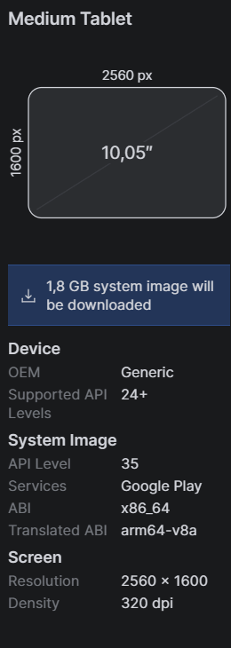

### Small Phone

_**Obsversaciones:**_ Tarda bastante en iniciarse, ya que primero hay que esperar a que arranque el teléfono del emulador antes de poder abrir la aplicación. Además, aparecen los botones de salir, volver, etc. en la parte inferior cuando está en vertical y en un lateral cuando está en horizontal. Por eso, hay que tener cuidado de no poner información importante o elementos que se puedan pulsar en esas zonas.

### Pixel 9 Pro XL

**_Obsversaciones:**_ Se inicia prácticamente al instante. No aparecen los botones que tiene el Small Phone, por lo que se puede aprovechar mejor toda la pantalla. Para salir se utiliza un gesto deslizando hacia arriba. En este dispositivo las letras y los elementos del centro se ven bastante más pequeños que en el Small Phone.

### Medium Tablet 

**_Obsversaciones:_** También se inicia muy rápido y funciona de forma parecida al Pixel 9 Pro. La principal diferencia es que, al tener una pantalla más grande, queda bastante espacio vacío y las letras y los elementos se ven todavía más pequeños.