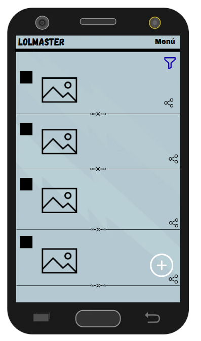
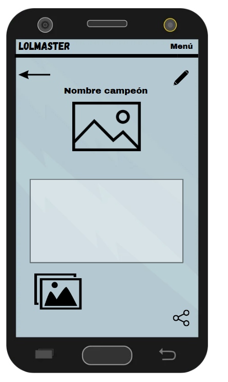
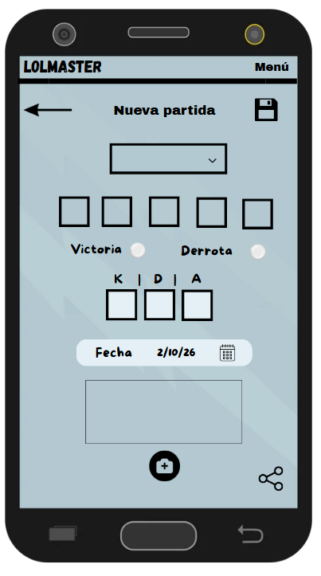

#### **Para el listado:**

Todo iría dentro del contenedor CoordinatorLayout para que el botón flotante se quede fijo mientras haces scroll hacia abajo.

Para poner el título y el menú desplegable utilizaría AppBarLayout, que sería el contenedor de la barra superior, y Toolbar donde iría el contenido visual que sería el nombre LolMaster y el menú desplegable.

Un Button para el botón de filtrado por fecha, campeón, victoria/derrota...

El resto iría un RecyclerView que agruparía todas las tarjetas.

Y un FloatingActionButton que destaque abajo a la derecha para añadir una nueva partida, como el botón en Gmail "redactar" para enviar un nuevo correo.

#### **Para el diseño de las tarjetas:**

Un LinearLayout (horizontal) para colocar los elementos uno al lado del otro en la tarjeta.

Un View que sería el recuadro pequeñito a la izquierda de la imagen, que cambiaría de color verde/rojo si es victoria o derrota.

Un ImageView donde iría la imagen del campeón de dicha partida.

Otro LinearLayout vertical donde vendrían metidos los textos todos agrupados:

* TextView para la fecha
* TextView para el score
* TextView para las notas
* ImageButton donde iría el icono de compartir.

#### **Para la pantalla de detalle de una tarjeta:**

Aquí pondríamos de contenedor el LinearLayout, porque no necesitamos ningún botón flotante como en la pantalla de listado.

Un Toolbar fijo en la parte superior con el título de la app y el menú.

Debajo pondríamos un LinearLayout horizontal donde estarían el resto de elementos fuera de la barra donde está el título y el menú.

Un ImageButton que sería una imagen de una flecha que al darle nos devolvería a la pantalla del listado.

Un View para empujar el siguiente botón a la derecha.

Y el otro ImageButton para el icono del lápiz que sería para editar el contenido de la partida.

Debajo pondríamos un ScrollView porque no sabemos exactamente cuánto le puede ocupar en la pantalla todos los elementos que estamos poniendo, así que esto es perfecto para poder verlo todo arrastrando hacia abajo.

Y dentro de este un LinearLayout (vertical) para organizar todos los elementos.

* TextView con el nombre del campeón.
* ImageView con la imagen del campeón.

Un LinearLayout con el fondo blanco donde iría:
* TextView con los datos de la partida: fecha, score, resultado...
* TextView con las notas del usuario.

Un LinearLayout horizontal con las imágenes opcionales que añadiría el usuario como máximo 5.

Por último un ImageButton con el icono de compartir.

#### **Para el formulario:**

El contenedor volvería a ser un LinearLayout.

Tendríamos también el toolbar con el título de la app y el menú.

Debajo pondríamos un LinearLayout horizontal donde iría:
* ImageButton con la flecha a la izquierda para volver al listado.
* TextView centrado con el título "Nueva partida"
* Un ImageButton a la derecha con el icono de guardar para guardar lo que estamos poniendo.

Un ScrollView para poder deslizar hacia abajo el contenido.

Y dentro un LinearLayout vertical para organizar todos los elementos:
* Centrado tendríamos un desplegable con autocompletado, un AutoCompleteTextView donde vas escribiendo el nombre del campeón y te van apareciendo campeones que empiecen por lo que estás escribiendo hasta que encuentras el tuyo y pinchas. En el desplegable aparece el nombre y la imagen del campeón.
* 5 Button con un LinearLayout en horizontal, uno con cada icono del carril del lol y lo seleccionas.
* Un RadioButton para marcas si has ganado o perdido.
* Abajo 3 EditText con LinearLayout en horizontal donde pones los números del KDA
* Un TextView con un LinearLayout en horizontal con el día actual por defecto y a su derecha un icono de un calendario que sería un ImageButton para seleccionar otro día.
* Un EditText grande con fondo blanco par añadir las notas.
* Un ImageButton con el icono "+" para añadir las imágenes.
* Y como siempre el ImageButton con el icono de compartir.
